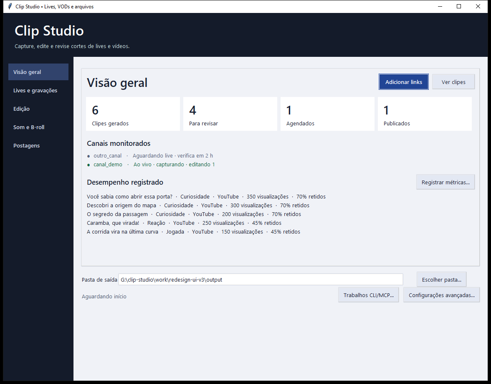
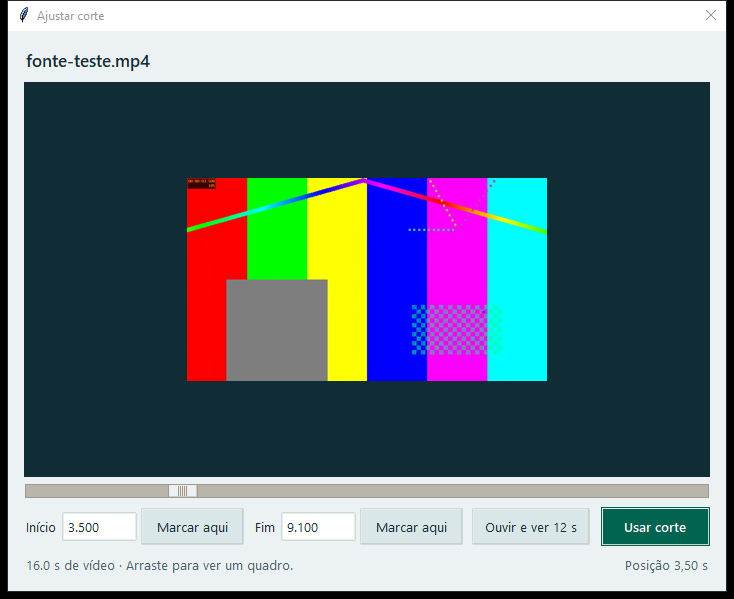
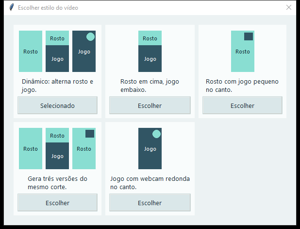
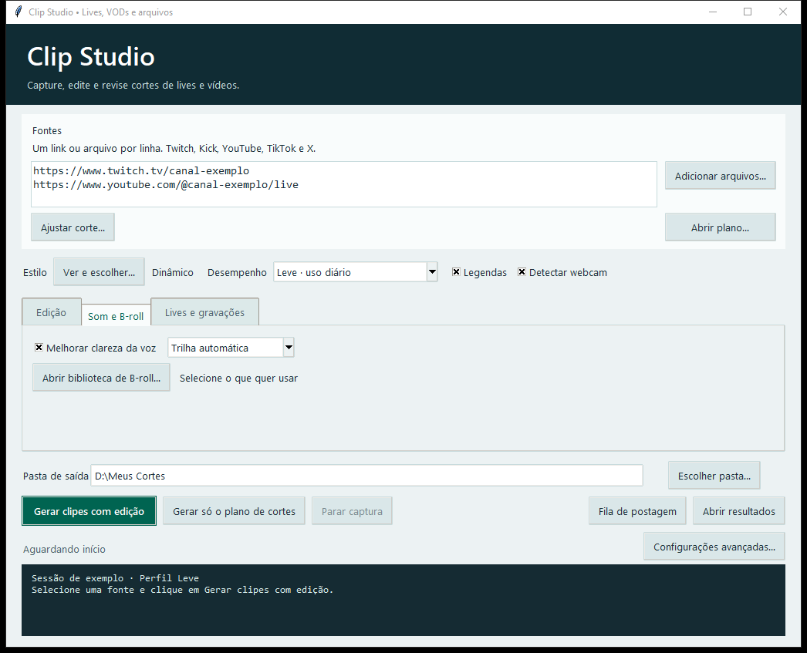
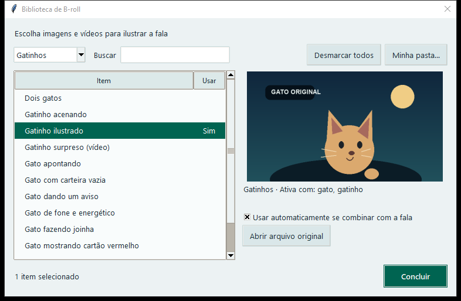
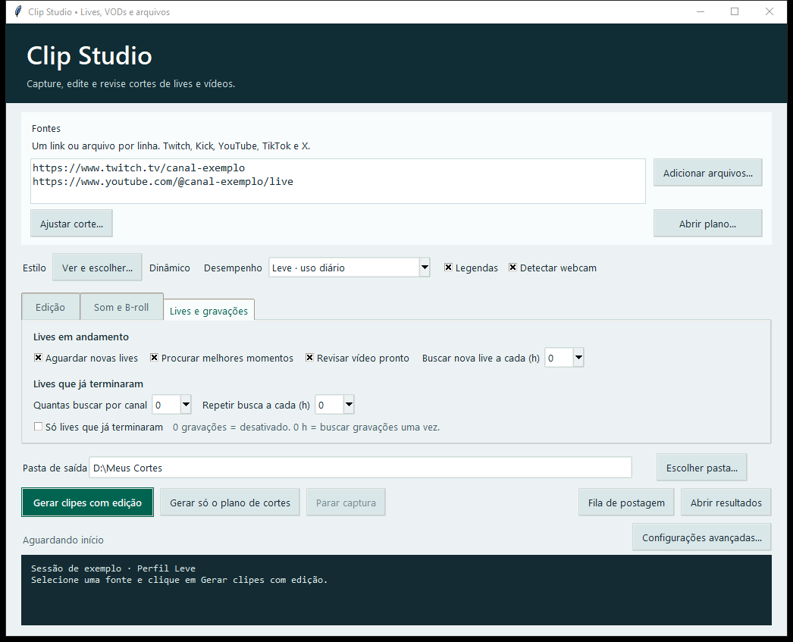
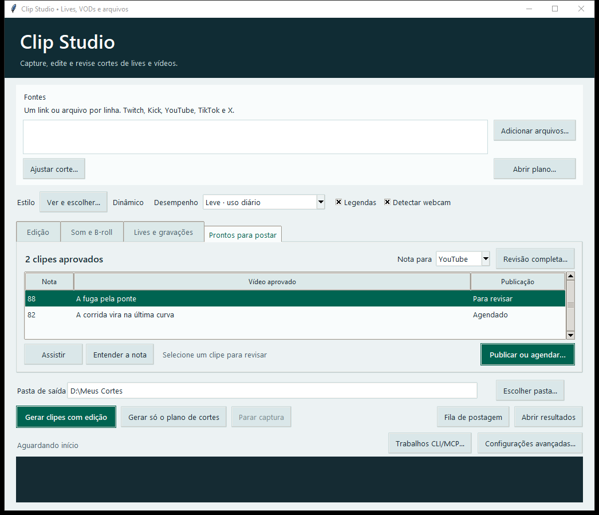
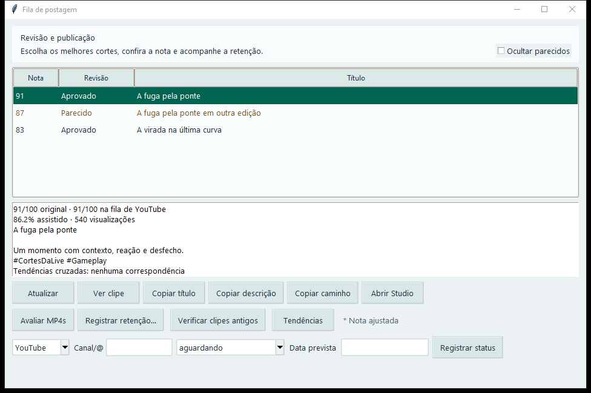

# Clip Studio

**Transforme lives e gravações em cortes verticais para Shorts, TikTok e Reels.** Aplicativo Windows para acompanhar canais, escolher momentos, editar com legendas e revisar clipes antes de publicar.

**Windows 10/11** · **Português** · **Código aberto sob MIT** · **v0.4.1**

**[Baixar para Windows](https://github.com/johnzerola/clip-studio/releases/latest/download/Clip-Studio-Windows.zip)** · [Guia ilustrado](docs/GUIA-DO-PAINEL.md) · [Arquitetura](docs/ARQUITETURA.md) · [Contribuir](#contribuir)

[Notas da versão 0.4.0](docs/RELEASE-0.4.0.md)



[Lives, postagens e modelos locais](docs/LIVES-E-POSTAGENS.md) · [Studio, UGC e integração OpenShorts](docs/INTEGRACAO-OPENSHORTS.md)

## O que dá para fazer

| Quero… | Onde fazer |
| --- | --- |
| Cortar um MP4 ou vídeo que já baixei | **Adicionar arquivos…** e **Ajustar corte…** |
| Descobrir momentos sem exportar ainda | **Gerar só o plano de cortes** e abrir o `cortes.json` em **Abrir plano…** |
| Acompanhar um canal ou buscar as transmissões anteriores | **Fontes** e **Lives e gravações** |
| Assinar os clipes com seu próprio @ | **Edição → @ do canal** |
| Comparar enquadramentos 9:16 | **Estilo → Ver e escolher…** |
| Usar trilha, melhorar a voz e escolher imagens de apoio | **Som e B-roll** |
| Escolher os melhores cortes para postar | **Postagens**, com player no painel e filtros por etapa |
| Assistir com o vídeo em destaque | **Postagens → Sala de revisão**. A **Galeria** mantém a prévia lateral |
| Ver horários e status por conta | **Agenda** |
| Escolher a aparência do painel | **Tema → Claro, Escuro ou Sistema** |
| Usar o computador enquanto o projeto roda | **Leve · uso diário**. Comece com um canal e acompanhe o registro |

## Baixar e instalar

1. [Baixe o ZIP da versão mais recente](https://github.com/johnzerola/clip-studio/releases/latest/download/Clip-Studio-Windows.zip). Para baixar o código da branch atual, use **Code → Download ZIP**.
2. Extraia todo o ZIP. Abra a pasta que contém **Instalar.cmd**, **Iniciar.cmd** e **README.md**. Prefira uma pasta sua, como `D:\Apps\Clip-Studio`.
3. Execute **Instalar.cmd**. O instalador prepara as bibliotecas Python dentro do projeto e cria o atalho **Clip Studio** na Área de Trabalho.
4. Se o instalador pedir Python ou FFmpeg, abra o **Prompt de Comando** na pasta extraída e execute:

   ```bat
   Instalar.cmd --automatico
   Instalar.cmd --verificar
   ```

5. Abra pelo atalho ou por **Iniciar.cmd**. O [guia de instalação](docs/INSTALACAO.md) explica requisitos, instalação manual, atualização e diagnóstico.

O painel consulta uma vez por dia a página pública de releases do GitHub. Quando uma versão mais recente fica disponível, ele oferece abrir a página para baixar a atualização. A consulta acontece em segundo plano e não exige chave. Para atualizar esta instalação inicial, baixe a versão nova em **Releases** e siga [Atualizar e preservar dados](docs/INSTALACAO.md#atualizar-e-preservar-dados).

[Instruções oficiais para baixar um ZIP do GitHub](https://docs.github.com/en/repositories/working-with-files/using-files/downloading-source-code-archives)

| Requisito | Para que serve |
| --- | --- |
| Windows 10 ou 11, 64 bits | Ambiente de instalação documentado |
| Python 3.13 x64 com Tkinter | Painel e automação. A opção automática usa WinGet |
| FFmpeg e FFprobe com H.264 e filtro ASS | Captura, vídeo, áudio, legendas e verificação. FFplay permite ouvir a prévia |
| Internet para instalar e ao usar links | O instalador baixa bibliotecas. A primeira transcrição pode baixar o modelo |
| 4 núcleos e 8 GB de RAM como ponto de partida | Um canal no modo Leve. 16 GB dão mais folga com Ollama |
| Ollama opcional | Ajuda a avaliar a narrativa e sugerir título e descrição. Sem ele, há regras locais |

O pacote contém o código, o instalador em script, os guias, as capturas de tela e dois exemplos de B-roll. Python, FFmpeg, modelos, perfis do navegador e mídias particulares ficam na máquina de cada pessoa.

## Fazer o primeiro corte

1. Clique em **Adicionar arquivos…** e escolha um vídeo local curto.
2. Em **Ajustar corte…**, arraste a régua e marque **Início** e **Fim**. Use **Usar corte** para levar as marcas à edição. Você também pode deixar o programa escolher os momentos.
3. Escolha o estilo em **Ver e escolher…**, confira **Legendas** e escolha a trilha em **Som e B-roll**.
4. Selecione uma **Pasta de saída**. Clique em **Gerar clipes com edição** e acompanhe o registro. Abra **Abrir resultados** para encontrar a sessão e a pasta **Clipes prontos**.
5. Se ativou **Revisar vídeo pronto**, a avaliação pode rejeitar um clipe. Consulte o registro. Na **Fila de postagem**, também dá para avaliar um MP4 que já existe.



### Estilos verticais e acabamento

O **Dinâmico** alterna rosto, gameplay e combinações conforme o trecho. Também há **Rosto em cima + jogo embaixo**, **Reação em tela + jogo no canto** e **Jogo em tela + facecam redonda**. **Exportar os três estilos** produz as versões dinâmica, dividida e reação quando há webcam identificada. Se a câmera não for localizada, o painel pode usar gameplay.

Os presets controlam remoção de silêncio, repetições e hesitações. Legendas destacam a fala e acompanham o enquadramento. O painel aplica J-cut quando existe áudio adequado para antecipar a próxima fala. Selecione **Trilha automática**, **Sem trilha** ou **Escolher arquivo**. A biblioteca permite habilitar cada item de B-roll. A inserção depende da relação com a fala e do espaço no plano.

<details>
<summary>Ver estilos, som e biblioteca</summary>







</details>

## Acompanhar lives e gravações

| Fonte | Ao vivo | Gravado |
| --- | --- | --- |
| Twitch | URL de canal | URL pública de VOD e busca dos últimos replays do canal |
| Kick | URL de canal | URL pública de VOD e busca dos últimos replays do canal |
| YouTube | URL da live ou `youtube.com/@canal/live` | Vídeo, Shorts e replays públicos de um canal |
| TikTok | URL pública `tiktok.com/@canal/live` | URL pública de vídeo |
| X | Publicação com transmissão pública ou link de broadcast | Use arquivo local para gravações já baixadas |

Cole um link por linha. Em **Lives e gravações**, escolha **Aguardar novas lives**, o intervalo de busca e, se quiser, as 2 ou 3 últimas gravações por canal suportado. A triagem ao vivo combina fala, áudio e movimento. Na Twitch, o volume de mensagens do chat entra como sinal adicional. O acesso depende do conteúdo estar disponível para o extrator, da região e da plataforma.



## Revisar e publicar

Em **Prontos para postar**, veja os clipes aprovados, assista e abra **Entender a nota**. **Revisão completa…** mostra clipes parecidos, descartes e retenção. Em **Registrar retenção…**, informe métricas da plataforma para calibrar a ordem com amostra suficiente.

No **YouTube**, conecte um cliente OAuth autorizado, confirme o canal e use **Enviar e agendar**. A plataforma cuida da publicação no horário que confirmar. No **TikTok**, a opção **Abrir Studio** copia a descrição e abre o destino para finalizar. [Guia de publicação e agendamento](docs/PUBLICACAO.md)





## Rodar no dia a dia

O modo **Leve** usa um render por vez, Whisper Tiny e prioridade abaixo da normal nos processos de mídia. Prefere captura de 480p ou 360p quando disponível. Em **Configurações avançadas**, a opção **Liberar espaço após exportar** limpa capturas gerenciadas que deixaram de ser necessárias. **Compacto** usa H.264 e, no modo Leve com libx264, codifica em uma etapa. A prévia por quadro funciona sem arquivos de proxy.

Em dois testes locais com o mesmo trecho sintético de 12 s, a exportação compacta levou **5,4–7,2 s**, ante **16,4–16,8 s** com o caminho anterior. O painel em repouso usou cerca de **48 MiB**. O impacto no FPS de um jogo e em sessões de 24 horas ainda precisa de medição. [Medições e critérios do perfil Leve](docs/REVISAO-LEVE.md)

## Documentação

| Guia | Conteúdo |
| --- | --- |
| [Instalação no Windows](docs/INSTALACAO.md) | Primeira instalação, verificação, atualização e erros comuns |
| [Guia do painel](docs/GUIA-DO-PAINEL.md) | Todas as telas e opções, com exemplos |
| [CLI e MCP integrados ao painel](docs/CLI-MCP.md) | Iniciar trabalhos, acompanhar status, consultar resultados e pedir parada |
| [Pesquisa de 35 repositórios e critérios da nota](docs/VIRALIDADE.md) | Chat, voz, movimento, edição de pausas e RAG local |
| [Publicação e agendamento](docs/PUBLICACAO.md) | Aba de clipes, OAuth YouTube e fluxo TikTok |
| [Arquitetura e integrações](docs/ARQUITETURA.md) | Motores, arquivos de saída, CLI, OTIO e MCP |
| [Modo Leve e revisão](docs/REVISAO-LEVE.md) | Prévia, similaridade, calibração e desempenho |
| [Pesquisa de 55 repositórios](docs/PESQUISA.md) | Referências e critérios de integração |
| [Publicar no GitHub](docs/PUBLICAR-NO-GITHUB.md) | Subir o conteúdo, anexar um ZIP e convidar um amigo |
| [Instalação assistida por IA](AGENTS.md) | Instruções para um assistente instalar e validar localmente |

## Contribuir

Quer ajudar a melhorar os cortes, a captura ou o painel? Abra uma [issue](https://github.com/johnzerola/clip-studio/issues/new/choose) ou envie um pull request. Testes em outros PCs, correções de documentação e sugestões de usabilidade também ajudam.

- **Desenvolvedores, equipes e empresas** podem propor integrações, contribuir com código ou testar fontes e formatos. O [guia de contribuição](CONTRIBUTING.md) explica como reproduzir e validar uma mudança.
- **Claude Code, ChatGPT e outros assistentes** podem começar por [AGENTS.md](AGENTS.md) e pelo [mapa dos módulos](docs/ARQUITETURA.md). O [guia para Claude Code](CLAUDE.md) aponta para o mesmo fluxo.
- **Áreas para colaborar** incluem acessibilidade da prévia, captura com reconexão, comparação de enquadramentos e medição de RAM e disco durante uma live.

## Licença

[Código sob licença MIT](LICENSE). O [Live Clipper](https://github.com/akm72-bit/live-clipper) foi a referência inicial. Dependências e mídias mantêm seus próprios termos. Os dois exemplos de B-roll incluídos têm [origem documentada](biblioteca/ORIGEM.md). Use material que você pode editar e publicar.

## Modelar e AI Video Director

O botão **Modelar…** importa presets aprovados de referências e inicia cortes pela fila com edição V9. [Como usar, CLI, MCP e limites](docs/MODELAR.md).
