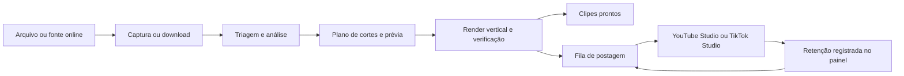

# Arquitetura e integrações

O Python coordena captura, análise, edição e render. O painel usa Tkinter. FFmpeg e FFprobe cuidam da mídia. Os bancos SQLite e os arquivos de sessão ficam no disco escolhido pelo usuário.



## Mapa do código

| Camada | Arquivos | Responsabilidade |
| --- | --- | --- |
| Instalação | `Instalar.cmd`, `Iniciar.cmd`, `scripts/install.ps1`, `scripts/launch.ps1`, `scripts/runtime.ps1`, `scripts/check.py` | Criar ambiente, localizar executáveis, verificar dependências e abrir o painel |
| Interface | `painel.py`, `tema.py`, `painel_visual.py`, `trim_preview.py`, `posting_panel.py` | Formulários, tema, prévia, biblioteca, estilos e navegação da fila |
| Entradas CLI | `cli.py`, `watch.py` | Arquivo local, lives e replays em terminal |
| Sessões | `sessions.py`, `runtime_profile.py`, `replay_library.py` | Agendamento interno, concorrência, prioridade e histórico de replays |
| Mídia | `engine.py`, `facecam.py`, `editorial.py` | Captura, inspeção audiovisual, transcrição, recorte e render |
| Triagem | `live_scout.py`, `viral_rank.py`, `final_screen.py`, `decision_bank.py` | Seleção, contagem de chat, avaliação editorial e revisão final |
| Acabamento | `finishing.py`, `audio_finish.py`, `v9_finish.py`, `broll_library.py`, `effects_bank.py`, `compression.py` | Legendas por palavra, transições, música, efeitos, inserts e compactação |
| Publicação assistida | `posting_queue.py`, `clip_quality.py` | Fila, similaridade, sugestões de texto e retenção |
| Intercâmbio | `review.py`, `makemyclip_adapter.py`, `effects_mcp.py` | OpenTimelineIO, adaptador e MCP de efeitos |

## Da fonte à entrega

1. **Entrada.** Streamlink resolve lives públicas de Twitch, Kick e YouTube. yt-dlp e FFmpeg atendem links compatíveis de TikTok e X. VOD remoto passa por download antes da edição. O DVR depende dos segmentos que a plataforma oferece.
2. **Seleção.** Áudio e movimento guiam a seleção inicial. Em live com triagem, o app analisa blocos de cerca de 15 s, usa Whisper Tiny e, na Twitch, conta mensagens recentes como sinal auxiliar. Ollama opcional avalia gancho, contexto, progressão e desfecho. Existem regras locais para fallback.
3. **Montagem.** O app aplica cortes manuais ou automáticos, cria a timeline por estilo e prepara legendas, voz, trilha e B-roll. A prévia manual busca quadros sob demanda e preserva as marcas de início e fim na edição.
4. **Exportação.** FFmpeg grava MP4 vertical. O perfil compacto Leve usa H.264 em uma etapa quando libx264 está disponível. Outros perfis podem transcodificar para H.264 ou H.265 e verificar o arquivo menor antes de substituir o temporário.
5. **Revisão.** Quando habilitada, verifica o MP4 e registra o motivo da aprovação ou rejeição. Similaridade usa hash exato, origem e intervalos, sequências da fala ou até três quadros reduzidos, conforme os dados disponíveis.
6. **Publicação.** O Studio da plataforma é aberto no navegador. Status, destino e métricas informadas são armazenados localmente. Retenção ajusta a ordem da fila com amostra suficiente, sem treinar o Ollama.

## Onde ficam os dados

| Local | Conteúdo |
| --- | --- |
| `preferencias.local.json`, `models/` | Preferências do painel e modelos Whisper da instalação |
| `biblioteca/`, `biblioteca.local/` | Exemplos do pacote e coleção particular |
| Pasta de saída › `AAAAmmdd_HHMMSS_ID/` | Sessão com `sessao.log`, `Capturas` e `Clipes prontos` |
| `Capturas/<fonte>/triagem.sqlite3` e `triagem.jsonl` | Sinais, notas, intervalos e motivos da triagem |
| `Clipes prontos/<fonte>/cortes.json` | Plano de edição e seus resultados |
| `clip_*.mp4` e `*.otio` | Vídeo entregue e, quando habilitada, timeline que referencia a mídia |
| `replays.sqlite3` | Histórico de gravações por plataforma e ID |
| `postagens.sqlite3` | Sugestões, similaridade, retenção e status |
| `tendencias.json`, `work/effect-previews/` | Termos informados pelo usuário e amostras de efeitos |

O JSON de edição versão 1 guarda `source`, `original_source`, `duration`, `method`, `unit` e `clips`. Cada clipe pode trazer `parts` em segundos, `removed`, `hook` e `variants`. `layouts` e `output` dão o plano principal e o arquivo principal. As variantes descrevem cada estilo, acabamento e revisão quando disponíveis. Em live, os tempos são relativos à mídia daquele bloco.

## Terminal no Windows

Rode na pasta instalada. Use uma pasta nova por execução de `cli.py`. Para consultar parâmetros, use `--help`.

```powershell
. .\scripts\runtime.ps1
Add-InstalledToolPaths
$py = ".\.venv\Scripts\python.exe"

# Planejar sem exportar
& $py -X utf8 .\cli.py "D:\Midia\live.mp4" --out "D:\Cortes\plano-01"

# Editar com legenda, webcam e limpeza
& $py -X utf8 .\cli.py "D:\Midia\live.mp4" --out "D:\Cortes\edicao-01" --style dynamic --auto-face --render --captions --cut-silence --cut-repeats --cut-fillers

# Monitorar um canal
& $py -X utf8 .\watch.py --performance leve --out "D:\Cortes" "https://www.twitch.tv/canal-exemplo"

# Repetir a busca de três gravações a cada duas horas
& $py -X utf8 .\watch.py --recent 3 --replay-hours 2 --replay-only --out "D:\Cortes" "https://kick.com/canal-exemplo"

# Exportar a timeline de um plano
& $py -X utf8 .\review.py "D:\Cortes\plano-01\cortes.json" --out "D:\Cortes\revisao.otio"
```

## Trabalhos compartilhados pelo painel, CLI e MCP

O registro local em `work/jobs.sqlite3` reúne as sessões iniciadas no painel, no `watch.py`, no `ClipJobs.cmd` e no MCP de trabalhos. A janela **Trabalhos CLI/MCP…** lê estado, eventos e caminho da sessão. Um trabalho controlado por vez evita que o painel e um cliente externo iniciem renderizações concorrentes. O processo de trabalho executa o mesmo motor do painel. [Guia da CLI e do MCP](CLI-MCP.md)

## Integrações opcionais

- **OpenTimelineIO.** A timeline aponta para a mídia de origem e referencia intervalos. Guarde a captura para editar depois. Confira a importação no editor de destino e use também o MP4 para ver efeitos compostos.
- **Banco de efeitos.** Use `effects_bank.py listar`, `effects_bank.py som impacto --pico -6` ou `effects_bank.py transicao dissolve` com o Python do projeto. Algumas transições funcionam como prévia pela ferramenta.
- **MCP.** Instale `requirements-mcp.txt` na mesma `.venv`. No cliente MCP, configure transporte stdio, a `.venv\Scripts\python.exe` como executável e o caminho de `effects_mcp.py` como argumento. FFmpeg precisa estar acessível ao cliente. As ferramentas incluem `list_effects`, `render_sound`, `render_transition`, `get_v9_reference` e `render_v9_accent`.
- **MakeMyClip.** `makemyclip_adapter.py clipe.mp4 --workspace pasta-nova` gera um plano de revisão para o MP4 composto. A execução externa exige uma instalação separada com `--node-entry`. Consulte `--help`. A compatibilidade depende da versão instalada.
- **V9.** A [skill de referência](../.agents/skills/alanzoka-v9-reference/SKILL.md) descreve enquadramento, transições e som. O vídeo original da referência fica com seu proprietário.

[Comparativo de repositórios](PESQUISA.md) · [Medições do perfil Leve](REVISAO-LEVE.md)
