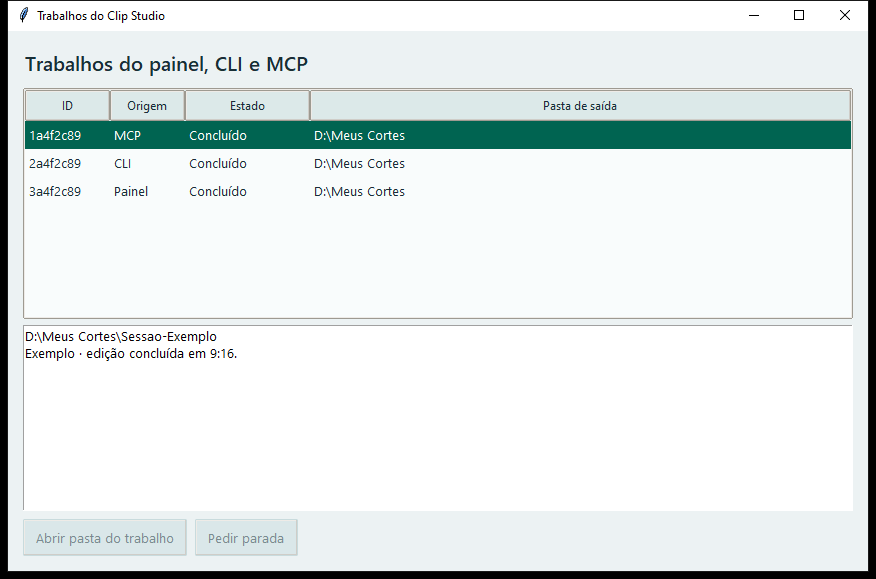

# CLI e MCP integrados ao painel

Use **Trabalhos CLI/MCP…** para ver a lista, acompanhar os registros e abrir a pasta de saída. O painel e as ferramentas de código usam a mesma instalação e seu registro local. A execução pela CLI ou pelo MCP continua mesmo que a janela do painel seja fechada.

O botão **Pedir parada** interrompe novas capturas e deixa o render atual terminar. A palavra **Concluído** indica fim de processamento. Um trabalho pode terminar sem clipe aprovado. Consulte os eventos e a lista de clipes.

## Terminal Windows

Instale o Clip Studio e execute de dentro da pasta instalada. Use caminhos completos para as fontes e a saída.

```bat
ClipJobs.cmd submit "D:\Midia\live.mp4" --out "D:\Cortes" --mode plan
ClipJobs.cmd submit "D:\Midia\live.mp4" --out "D:\Cortes" --ranges "1:00-1:34" --wait
ClipJobs.cmd submit "https://www.twitch.tv/canal-exemplo" --out "D:\Cortes" --minutes 5
ClipJobs.cmd list
ClipJobs.cmd status ID_DO_TRABALHO
ClipJobs.cmd outputs ID_DO_TRABALHO
ClipJobs.cmd cancel ID_DO_TRABALHO
```

`submit` inicia em segundo plano e retorna um ID. Adicione `--wait` para esperar o resultado. `status ID --after SEQ` lê eventos após a última sequência que você recebeu. `outputs` lista caminhos de MP4 e dos planos `cortes.json`. Além da CLI nova, `watch.py` registra suas sessões na mesma janela e mantém as opções de busca de replays. A CLI `cli.py` continua disponível para execução direta em uma pasta de saída própria.

## MCP de trabalhos

Instale as dependências opcionais na mesma instalação:

```powershell
.\.venv\Scripts\python.exe -m pip install -r requirements-mcp.txt
```

Exemplo de configuração de um cliente MCP stdio. Substitua os caminhos pelo diretório que você instalou.

```json
{
  "mcpServers": {
    "clip-studio": {
      "command": "D:\\Apps\\Clip-Studio\\.venv\\Scripts\\python.exe",
      "args": ["-X", "utf8", "D:\\Apps\\Clip-Studio\\clip_mcp.py"]
    }
  }
}
```

| Ferramenta | O que faz |
| --- | --- |
| `start_job` | Recebe `request` com fontes, pasta de saída e opções. Inicia o motor |
| `jobs` | Lista sessões recentes do painel, da CLI e do MCP |
| `job_status` | Devolve estado, pasta e eventos. Use `after` para consultar incrementos |
| `job_outputs` | Lista MP4s e planos de edição gerados |
| `cancel_job` | Solicita parada do trabalho pelo ID |

Exemplo de argumentos de `start_job`:

```json
{
  "request": {
    "sources": ["D:\\Midia\\live.mp4"],
    "output": "D:\\Cortes",
    "mode": "render",
    "style": "dynamic",
    "seconds": 45,
    "performance": "leve",
    "captions": true
  }
}
```

O servidor de trabalhos usa stdio. Use o MCP com clientes locais de confiança e com acesso às mídias e pastas selecionadas. O MCP de efeitos em `effects_mcp.py` continua separado. A CLI integrada aceita MP4s e URLs públicas que o motor já suporta; a disponibilidade depende da plataforma.


