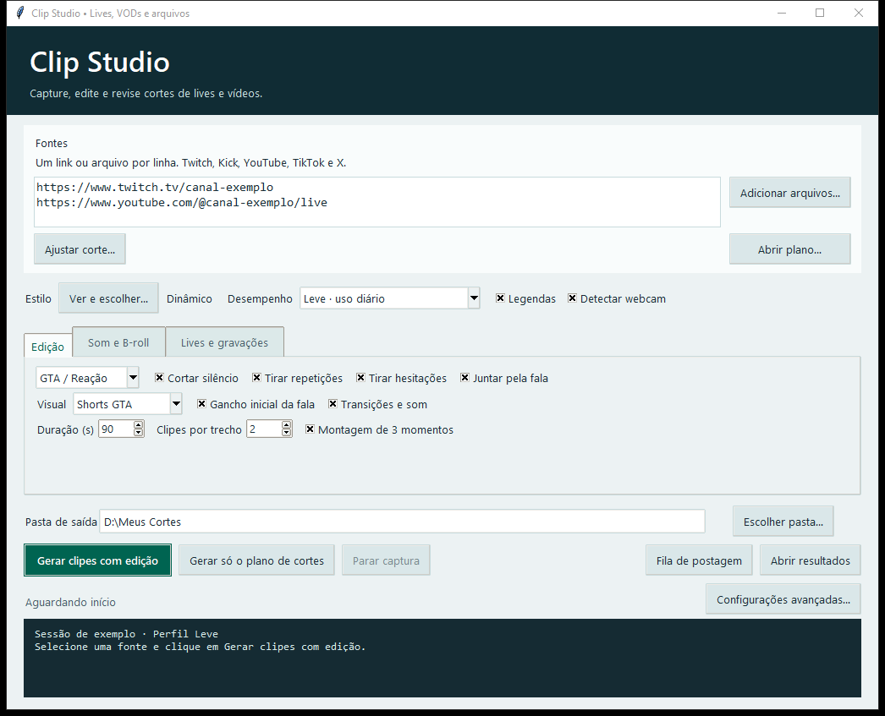
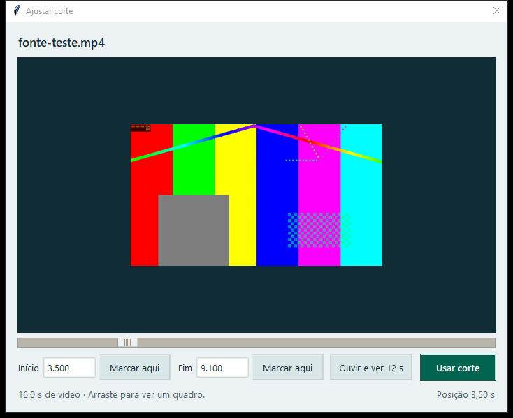
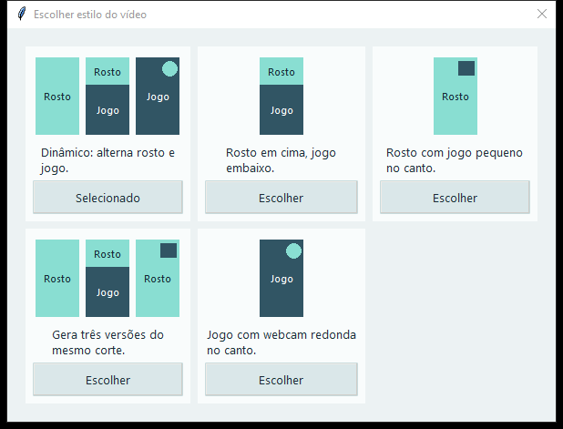
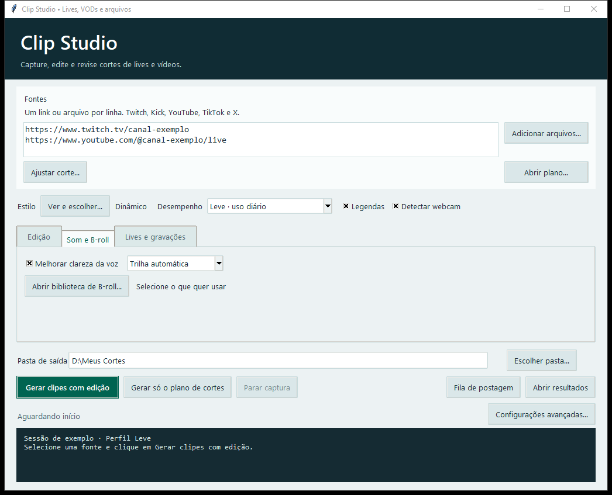
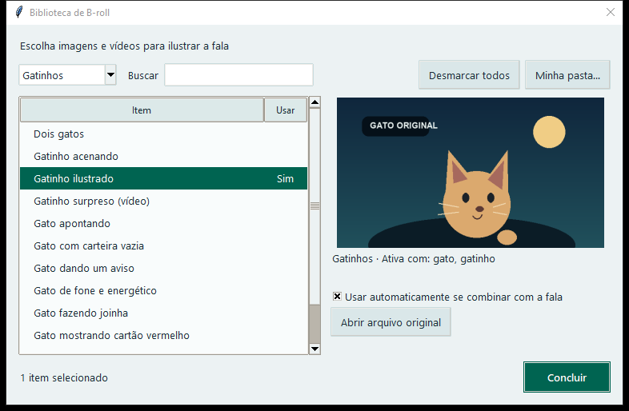
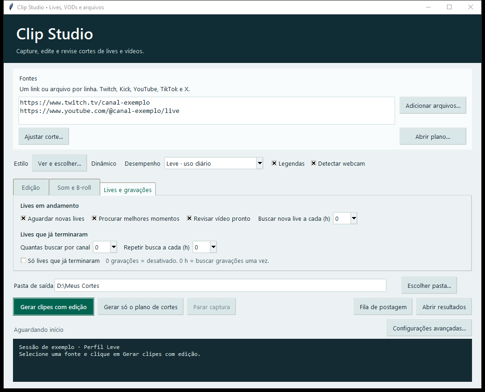
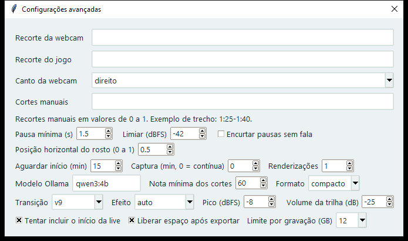
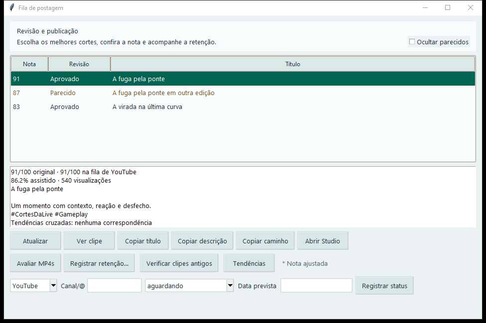
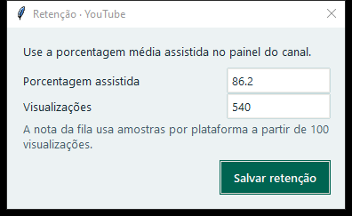
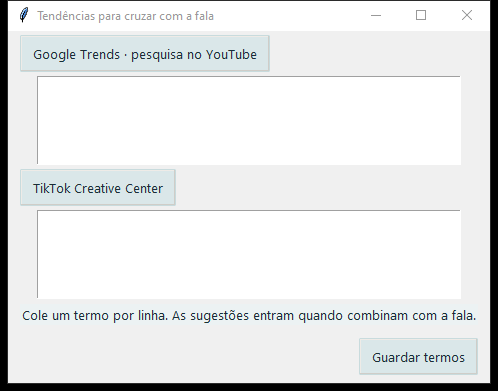

# Guia ilustrado do painel

As dez capturas mostram o aplicativo com dados fictícios. O vídeo da prévia é sintético. A biblioteca mostra um gatinho incluído no pacote.

## 1. Fontes, edição e resultados

| Controle | Para que serve |
| --- | --- |
| **Fontes / Adicionar arquivos…** | Um link ou arquivo por linha. O botão preenche o campo com os caminhos escolhidos |
| **Ajustar corte… / Abrir plano…** | Ajuste um vídeo local ou escolha um corte de um `cortes.json`. A fonte precisa continuar acessível |
| **Estilo / Desempenho** | Escolha a composição 9:16 e o perfil **Leve** ou **Equilibrado** |
| **Legendas / Detectar webcam** | Ative legendas e identificação de uma câmera de rosto recorrente |
| **GTA / Reação, Conversa, Sem limpeza** | Escolha um preset e refine silêncio, repetições, hesitações e encaixe pela fala |
| **Visual / Gancho inicial da fala / Transições e som** | Escolha a aparência, a chamada extraída da fala e o acabamento |
| **Duração / Clipes por trecho / Montagem de 3 momentos** | Defina o alvo de 10–180 s, até oito cortes por análise e a busca de montagens com trechos cronológicos |
| **Pasta de saída** | Recebe sessões, resultados e os bancos de replays e postagem |
| **Gerar clipes com edição / Gerar só o plano de cortes** | Exporte MP4 ou grave o plano em JSON para revisar |
| **Parar captura / Abrir resultados** | Sinalize a parada e deixe a fila terminar, ou abra a pasta escolhida |

## 2. Prévia e estilos

Arraste a régua e marque **Início** e **Fim** ou digite os tempos. **Ouvir e ver 12 s** abre uma amostra com áudio no FFplay. **Usar corte** aplica as marcas à próxima exportação. Em um plano com montagem, use o seletor para rever cada trecho. A prévia mostra a fonte antes dos efeitos.

| Estilo | Composição |
| --- | --- |
| **Dinâmico** | Alterna layouts conforme a atividade do trecho |
| **Rosto em cima + jogo embaixo** | Webcam e jogo empilhados |
| **Reação em tela + jogo no canto** | Rosto em destaque e jogo em janela pequena |
| **Exportar os três estilos** | Dinâmico, dividido e reação quando há webcam disponível |
| **Jogo em tela + facecam redonda** | Gameplay em destaque com webcam circular no canto |

## 3. Som e imagens de apoio

**Melhorar clareza da voz** ativa tratamento e nivelamento. Escolha trilha automática, sem trilha ou um arquivo próprio. **Sem trilha** desliga a música acrescentada e preserva o áudio da fonte. O J-cut entra quando há áudio adequado para antecipar o trecho seguinte.

Filtre por categoria e marque **Usar automaticamente se combinar com a fala** no item desejado. Em **Minha pasta…**, aponte para a sua mídia. Nomes como `churrasco.jpg` ou `vice-city.mp4` ajudam a associar arquivos às falas. O motor tenta inserir até um item por corte, quando há correspondência e tempo suficiente. O pacote inclui dois gatinhos com [origem documentada](../biblioteca/ORIGEM.md).

## 4. Lives e gravações

- **Aguardar novas lives** mantém o monitor ativo com a duração de captura em zero. **Buscar nova live a cada (h)** aceita 1, 2 ou 3 horas. **0** usa a espera curta padrão de 45 s no monitoramento de canal offline.
- **Procurar melhores momentos** ativa a triagem durante a captura. **Revisar vídeo pronto** verifica a entrega e alimenta a fila.
- **Quantas buscar por canal** procura as 2 ou 3 últimas gravações disponíveis da Twitch, Kick ou YouTube. **0** desativa a busca. **Repetir busca a cada (h)** usa 0 para uma busca e 1, 2 ou 3 para repetir durante a sessão.
- **Só lives que já terminaram** executa apenas a busca de gravações. Informe a quantidade. Para buscar periodicamente, inicie **Gerar clipes com edição**.
- Mantenha o programa aberto e o computador ligado enquanto quiser monitorar. O registro e `sessao.log` ajudam a localizar erros.

## 5. Configurações avançadas

| Grupo | Campos |
| --- | --- |
| Recortes | Webcam e jogo usam `x,y,largura,altura` de 0 a 1. Também há canto da webcam e posição horizontal do rosto |
| Tempos | **Cortes manuais** aceita `1:25-1:40, 1:48-2:00`. Pausa mínima, limiar e encurtamento de pausas ajustam a limpeza |
| Captura | Espera inicial, duração e concorrência. **Tentar incluir o início da live** aproveita DVR público quando disponível |
| Seleção | **Modelo Ollama** opcional e **Nota mínima dos cortes** da revisão |
| Acabamento | Transição, efeito, pico isolado, volume da trilha e formato `original`, `compacto` ou `hevc` |
| Disco | **Liberar espaço após exportar** limpa capturas gerenciadas. **Limite por gravação** controla downloads de VOD |

## 6. Fila, retenção e tendências

- **Avaliar MP4s** analisa clipes verticais de até 180 s. **Verificar clipes antigos** avalia até 30 registros por vez. **Ocultar parecidos** controla a exibição de alternativas.
- **Ver clipe** abre o MP4. Os botões **Copiar** preparam título, descrição e caminho. **Abrir Studio** leva ao YouTube ou TikTok. **Registrar status** guarda a anotação por destino e conta. O envio, o agendamento e a publicação são feitos no Studio.
- **Registrar retenção…** usa porcentagem média assistida e visualizações do painel do canal, inclusive percentuais acima de 100% quando há repetição. [Critérios de calibração](REVISAO-LEVE.md)
- Em **Tendências**, informe termos que consultou. A fila indica a origem dos termos que combinam com a fala.

