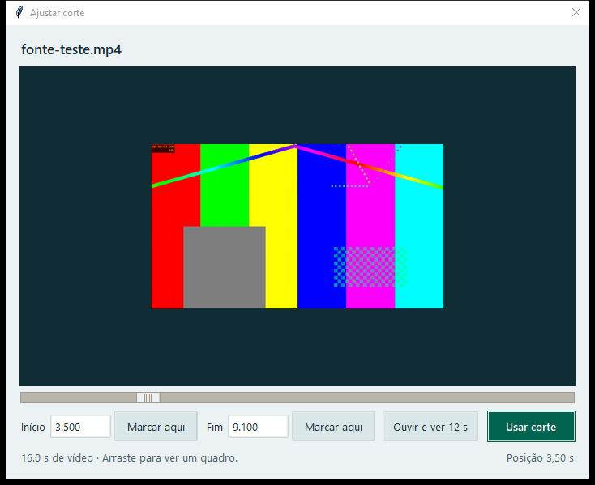

# Revisão de clipes no modo Leve

## O fluxo no painel

1. Adicione um vídeo local e abra **Ajustar corte…**. Use a régua para ver um quadro e marcar o início e o fim. **Ouvir e ver 12 s** toca o começo do trecho no FFplay. **Usar corte** leva as marcas para a exportação.
2. Quem já gerou um plano pode abrir o `cortes.json` em **Abrir plano…** e escolher um corte. O vídeo de origem precisa estar disponível. Planos com montagem permitem ajustar cada trecho separadamente.
3. Na **Fila de postagem**, clipes parecidos ganham marca própria e ficam fora do destaque de três sugestões. Os arquivos continuam disponíveis. **Ocultar parecidos** limpa a lista e **Verificar clipes antigos** analisa até 30 por ação.
4. Escolha YouTube ou TikTok e use **Registrar retenção…**. Informe a porcentagem média assistida e as visualizações do painel do canal. A nota original permanece visível.

A prévia lê a fonte em baixa resolução, com um quadro por vez e sem criar arquivos de proxy. A reprodução é uma amostra da fonte antes de aplicar efeitos e legendas. A duração selecionada na prévia aceita até 180 segundos de conteúdo por corte. Um replay precisa estar baixado para a revisão manual. A captura ao vivo continua com a seleção automática.

## O que aproveitamos das ferramentas

| Referência | O que entrou | Desenvolvimento possível |
|---|---|---|
| OpusClip | Nota, destaque e edição de marcas no mesmo fluxo | Comparar curvas de retenção junto ao corte |
| LosslessCut | Revisão da fonte e ajuste de início e fim sem render definitivo | Atalhos de teclado e navegação por quadro |
| Shotcut | Qualidade da prévia separada da qualidade final | Proxy opcional e limitado para fontes que decodificam mal |
| faster-whisper | Reutilização do Tiny em CPU INT8 no modo Leve | Medir outra biblioteca com a mesma mídia, legenda e carga antes de adotá-la |
| YouTube Analytics | Porcentagem assistida e volume de views informados por plataforma | Importar métricas por OAuth se houver conta e integração autorizadas |

- [OpusClip no TikTok Creative Center](https://ads.tiktok.com/business/creativecenter/creative-app-info/OpusClip/pc/en?id=7296382339217620993)
- [LosslessCut no GitHub](https://github.com/mifi/lossless-cut)
- [Documentação do Shotcut sobre escala de prévia](https://forum.shotcut.org/pub/preview-scaling)
- [faster-whisper no GitHub](https://github.com/SYSTRAN/faster-whisper)
- [Métricas do YouTube Analytics](https://developers.google.com/youtube/analytics/metrics)

O comparativo mais amplo está em [Pesquisa de repositórios](PESQUISA.md). A interface mantém tipografia Segoe UI e paleta verde-petróleo, com ações principais junto ao conteúdo e um tom âmbar distinto para indicar similaridade.

## Limites e recursos

- A fila compara conteúdo idêntico, sobreposição de recortes na mesma fonte, sequências de palavras e, para clipes com pouca fala, três quadros reduzidos. A comparação procura coincidências fortes. Cortes bem reenquadrados, sem fala ou com poucos quadros em comum podem escapar.
- A calibração começa com cinco observações da mesma plataforma, cada uma com pelo menos 100 visualizações. Cada faixa de nota usa ao menos três observações, com ajuste de até 8 pontos na ordem da fila. A pontuação original e o critério de aprovação continuam disponíveis. As métricas são cadastradas manualmente.
- No modo Leve, há um render por vez, um thread configurado para Whisper Tiny e FFmpeg abaixo da prioridade normal. O Ollama recebe um thread de CPU e expiração em 30 segundos de inatividade. A captura tem reserva de 2 GiB. Para H.264 compacto, o vídeo já sai compactado da primeira codificação quando libx264 está disponível.
- Em dois testes com o mesmo trecho sintético de 12 s, a exportação compacta levou 5,4–7,2 s, contra 16,4–16,8 s com o caminho anterior. O tamanho caiu de 1,30 MB para 1,14 MB. A amostra da prévia foi extraída em cerca de 1 s. Os números variam com a fonte, o codec e a carga do PC. FPS durante um jogo, consumo total de RAM e operação por 24 horas ainda precisam de medição.
- Python coordena jobs, janelas e SQLite. Os trabalhos de mídia já rodam em FFmpeg e no motor nativo CTranslate2. Rust foi considerado como opção de backend, com adoção condicionada a uma redução medida de CPU, RAM ou disco no trabalho completo.

